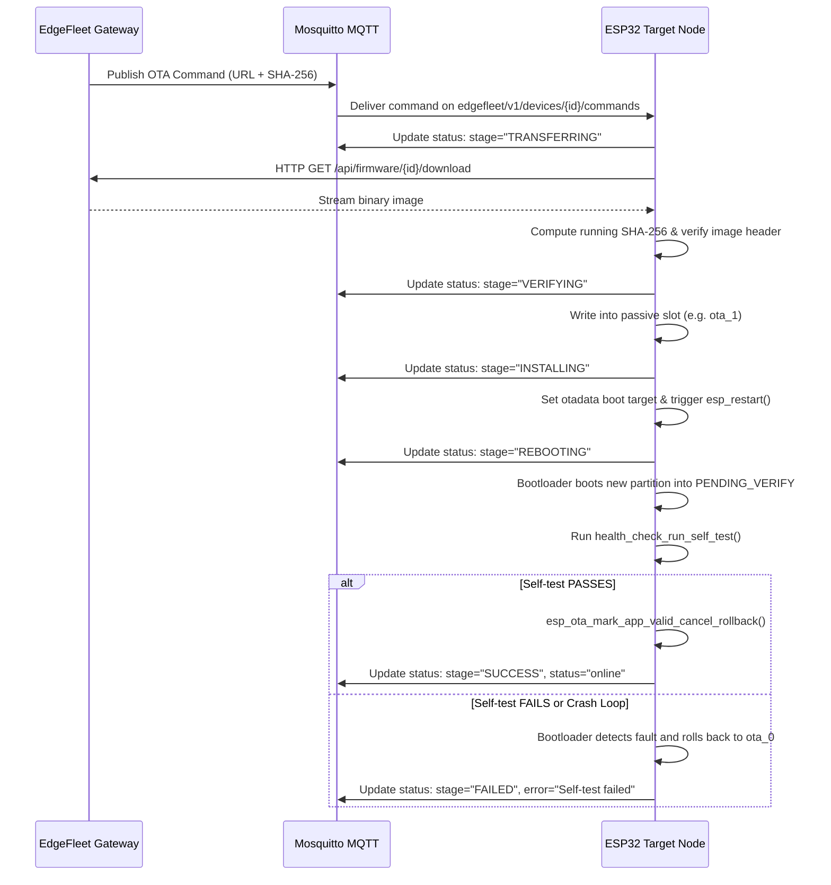

# Firmware Update Guide & Mechanics

This guide provides deep technical documentation on how EdgeFleet executes and verifies firmware deployments across heterogeneous microcontroller architectures.

---

## 1. ESP32 Wi-Fi Dual-Partition OTA Architecture

EdgeFleet utilizes the **ESP-IDF Native OTA Subsystem** with an A/B dual partition layout.

### 1.1 Flash Memory Partition Layout (`partitions.csv`)

```
0x000000 ┌────────────────────────────────────────┐
         │ 2nd Stage Bootloader                   │
0x009000 ├────────────────────────────────────────┤
         │ NVS Key-Value Storage (16 KB)          │
0x00D000 ├────────────────────────────────────────┤
         │ otadata Partition (8 KB)               │
0x00F000 ├────────────────────────────────────────┤
         │ PHY Calibration Data (4 KB)            │
0x010000 ├────────────────────────────────────────┤
         │ Factory App Slot (1.3 MB)              │
0x160000 ├────────────────────────────────────────┤
         │ ota_0 App Slot (1.3 MB)                │
0x2B0000 ├────────────────────────────────────────┤
         │ ota_1 App Slot (1.3 MB)                │
         └────────────────────────────────────────┘
```

### 1.2 OTA Execution Sequence



---

## 2. Arduino Uno (ATmega328P) USB Serial Flashing

Arduino Uno boards lack Wi-Fi, secondary partitions, and dual-bank flash memory. EdgeFleet manages Arduino nodes as locally connected USB peripherals via `avrdude`.

### 2.1 The Optiboot Flashing Protocol
1. **Device Identification**: The gateway checks `/dev/ttyACM0` or `/dev/ttyUSB0` matching the registered device.
2. **Serial Lock Acquisition**: The gateway acquires an exclusive async lock on the target TTY port so other tasks cannot write serial frames simultaneously.
3. **DTR Auto-Reset**: When `avrdude` opens the serial port with baud rate 115200, the USB-to-UART chip toggles DTR low, pulsing the ATmega328P `RESET` pin.
4. **Bootloader Handshake**: The Optiboot bootloader runs for 500ms, receiving the `STK500v1` protocol synchronization packet (`0x30 0x20`).
5. **Page Write & Verification**: The Intel HEX payload is written page-by-page (128 bytes per page) and read back to verify flash checksum.
6. **Execution & Release**: The lock is released, and the gateway listens for the device's boot greeting on serial.

### 2.2 Subprocess Invocation Safety
The gateway issues `avrdude` directly using immutable argument tokens:
```bash
/usr/bin/avrdude -p atmega328p -c arduino -P /dev/ttyACM0 -b 115200 -U flash:w:/var/lib/edgefleet/firmware/uno_1_0_0_abc12345.hex:i
```
No shell environment is spawned, and parameters are validated prior to execution.

---

## 3. ESP32 Direct USB/Serial Cable Flashing (`esptool`)

In addition to wireless OTA, EdgeFleet supports direct USB/serial cable connections for ESP32 nodes. This enables initial provisioning ("first-boot flash"), recovery from corrupted wireless partitions, or operating in environments where Wi-Fi is disabled.

```
┌─────────────────────────────────┐                 ┌─────────────────────────────┐
│       EdgeFleet Gateway         │   USB Cable     │         ESP32 Node          │
│  (Raspberry Pi or Windows Host) │ ──────────────> │ (DevKit / Custom ESP32-WROOM│
│   • ESP32SerialAdapter          │  CP2102 / CH340 │   • ROM Bootloader          │
│   • python -m esptool           │  460800 baud    │   • Flash Offset 0x10000    │
│   • scripts/serial_gateway.py   │  115200 telem.  │   • Serial UART Telemetry   │
└─────────────────────────────────┘                 └─────────────────────────────┘
```

### 3.1 Hardware Connection & Cable Requirements
1. **Data Cable**: Always use a full 4-wire USB data cable (VBUS, D-, D+, GND). Power-only/charge-only cables will not expose a serial COM port.
2. **Supported USB-to-UART Bridges**:
   - **Silicon Labs CP2102 / CP2104** (Vendor ID `0x10C4`, Product ID `0xEA60`)
   - **WCH CH340 / CH341** (Vendor ID `0x1A86`, Product ID `0x7523`)
   - **FTDI FT232R** (Vendor ID `0x0403`, Product ID `0x6001`)
   - **Espressif Native USB-JTAG/Serial CDC** on ESP32-S2, ESP32-S3, ESP32-C3 (Vendor ID `0x303A`)

### 3.2 Port Identification & Operating System Permissions
- **Windows**: The ESP32 enumerates as `COM3`, `COM4`, etc.
  - Verify in Windows Device Manager under **Ports (COM & LPT)**.
  - EdgeFleet automatically enumerates COM ports via `GET /api/devices/ports/serial`.
- **Linux / Raspberry Pi**: The ESP32 enumerates as `/dev/ttyUSB0` or `/dev/ttyACM0`.
  - Add your user to the `dialout` group to allow serial access without root:
    ```bash
    sudo usermod -a -G dialout $USER
    # Log out and log back in for changes to take effect
    ```
  - Optional udev rule (`/etc/udev/rules.d/99-esp32.rules`):
    ```udev
    SUBSYSTEM=="tty", ATTRS{idVendor}=="10c4", ATTRS{idProduct}=="ea60", MODE="0666", GROUP="dialout"
    SUBSYSTEM=="tty", ATTRS{idVendor}=="1a86", ATTRS{idProduct}=="7523", MODE="0666", GROUP="dialout"
    SUBSYSTEM=="tty", ATTRS{idVendor}=="303a", MODE="0666", GROUP="dialout"
    ```

### 3.3 The esptool Cable Flashing Procedure
When an ESP32 is registered with a `serial_port` (e.g. `COM3` or `/dev/ttyUSB0`), EdgeFleet's `DeploymentService` automatically routes deployments to `ESP32SerialAdapter`:

1. **Port Lock Acquisition**: Acquires an exclusive `asyncio.Lock` on the serial port to prevent port contention between the serial monitor and the flasher.
2. **Verification**: Computes the SHA-256 checksum of the target `.bin` image on disk and validates it against the approved release metadata.
3. **Flashing via `esptool`**:
   The gateway runs `esptool` safely via non-blocking subprocess without `shell=True`:
   ```bash
   python -m esptool --port COM3 --baud 460800 --chip esp32 write_flash 0x10000 firmware_release.bin
   ```
   - **Application Offset**: By default, writes to `0x10000` (factory partition).
   - **High-Speed Baud Rate**: 460800 baud allows flashing a 1.2 MB binary in under 20 seconds.
4. **Auto-Reset & Reboot**:
   `esptool` automatically asserts RTS and DTR pins through the on-board transistor auto-reset circuit, rebooting the ESP32 into the new application.
5. **Health Check & Verification**:
   The gateway checks the return code (0) and verifies binary byte count before reporting `SUCCESS` to the dashboard.

### 3.4 Live Telemetry Ingestion Over Cable
EdgeFleet can read live telemetry streaming over the USB cable directly:
- The ESP32 firmware emits JSON lines at 115200 baud over its UART console:
  ```json
  {"schema_version":"1.0","device_id":"esp32-001","temperature":24.50,"humidity":55.20,"heap_free":184320,"rssi":-58,"uptime":120}
  ```
- **CLI Serial Gateway**: Run the built-in gateway tool to display telemetry and forward to EdgeFleet:
  ```bash
  python scripts/serial_gateway.py --scan
  python scripts/serial_gateway.py --port COM3 --baud 115200
  ```
- **Dashboard Serial Port Scanner**: In the EdgeFleet Dashboard, go to **Device Inventory** -> **Register Device** or **Device Diagnostics** -> **Network & Physical Ports** to scan and assign the connected USB cable with 1 click.
