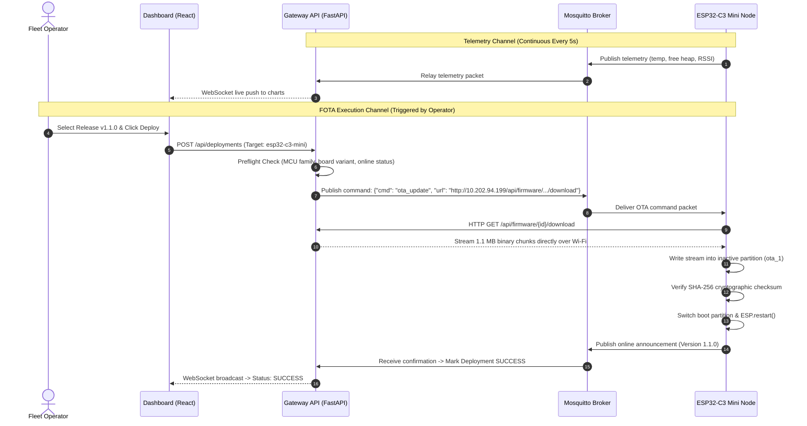

# EdgeFleet: Presentation Slide Deck (8 Core Slides)
### *Includes System Block Diagrams, Flow Diagrams & AI Image Prompts*

---

## Slide 1: The Problem — The IoT Maintenance & Update Challenge

### Slide Title
**The Challenge: Managing & Updating Distributed IoT Microcontrollers**

### Key Takeaway
Remote microcontrollers are physically inaccessible, risky to update, and vulnerable to permanent failure ("bricking").

### Slide Content (Bullet Points)
- **Physically Inaccessible Hardware**: Nodes deployed in high factory ceilings, agricultural fields, or utility poles where physical access is expensive or impossible.
- **The "Bricking" Disaster**: An interrupted flash, power dip, or corrupt binary leaves the microcontroller permanently non-bootable, requiring manual chip replacement.
- **Heterogeneous Environments**: Fleets mix disparate hardware—modern 32-bit Wi-Fi microcontrollers (**ESP32-C3 Mini**) alongside rugged 8-bit industrial controllers (**Arduino Uno**).
- **Single-Point Cloud Failures**: Cloud-only IoT platforms (Blynk, AWS IoT, ThingSpeak) demand constant internet, incur recurring fees, and fail when local network connectivity drops.

### AI Image Generation Prompt
> *Prompt for Midjourney / DALL-E / Nano:*  
> `"Minimalist cinematic 3D illustration of an industrial factory floor with a robotic arm and high utility poles. In the background, a technician is holding a laptop with dangling USB cables looking frustrated. A faint red holographic warning symbol floats above an embedded sensor node. Dark slate gray and navy blue corporate tech aesthetic, clean lighting, 8k resolution, isometric perspective --ar 16:9"`

---

## Slide 2: The Solution — EdgeFleet Platform Overview

### Slide Title
**EdgeFleet: Edge-Native Fleet Management & Safe FOTA Platform**

### Key Takeaway
A sovereign on-premise gateway that unifies heterogeneous microcontrollers with atomic remote updates and real-time observability.

### Slide Content (Bullet Points)
- **Autonomous Local Gateway**: Powered by a Raspberry Pi 4 operating on-site, managing fleet devices autonomously even during complete internet blackouts.
- **Multi-Architecture Support**: Centrally orchestrates both wireless **ESP32-C3 Mini** nodes (via Wi-Fi) and wired **Arduino Uno** nodes (via USB serial).
- **Fail-Safe Firmware Over-The-Air (FOTA)**: Atomic updates with preflight hardware checks and automatic rollback protection.
- **Real-Time Web Dashboard**: A single browser-based interface for live telemetry streaming, device status tracking, and 1-click deployments.

### AI Image Generation Prompt
> *Prompt for Midjourney / DALL-E / Nano:*  
> `"A sleek, modern edge IoT gateway hub device glowing with soft cyan and green LED status rings on an industrial server table. Glowing wireless signal waves radiate outward to small nearby microcontrollers and sensors. Clean high-tech aesthetic, subtle glassmorphism reflections, minimalist dark studio background, futuristic enterprise technology --ar 16:9"`

---

## Slide 3: System Architecture — 3-Tier Layered Hierarchy

### Slide Title
**System Architecture: 3-Tier Layered Hierarchy**

### Key Takeaway
Clean architectural separation between operator presentation, edge gateway orchestration, and physical microcontroller execution.

### Slide Content (Bullet Points)
- **Tier 1: Operator Presentation Layer (Frontend)**
  - Web dashboard built with **React 18** and **TypeScript**.
  - Bidirectional **WebSockets** for live sub-second telemetry and deployment progress.
- **Tier 2: Edge Gateway Controller (Raspberry Pi 4)**
  - **FastAPI Engine**: Asynchronous core handling API requests, RBAC security, and deployment jobs.
  - **Mosquitto MQTT Broker**: High-throughput message bus for lightweight telemetry and commands.
  - **Local SQLite Database (WAL Mode)**: Fast concurrent local storage for telemetry logs and firmware binaries.
- **Tier 3: Distributed Edge Hardware (Physical Nodes)**
  - **ESP32-C3 Mini**: 32-bit RISC-V core with Wi-Fi, dual A/B flash partitions, and status LEDs.
  - **Arduino Uno**: 8-bit AVR ATmega328P connected via USB serial for rugged sensing.

### System Architecture Block Diagram

```mermaid
graph TD
    subgraph Tier1 ["Tier 1: Operator Presentation Layer"]
        UI["Web Dashboard (React 18 + TypeScript)<br/>Real-Time Fleet View & Binary Registry"]
    end

    subgraph Tier2 ["Tier 2: Raspberry Pi 4 Edge Gateway"]
        Nginx["Nginx Reverse Proxy (:80)"]
        API["FastAPI Orchestrator (Async Python 3.11)"]
        DB[("SQLite Database (WAL Mode)<br/>Devices • Releases • Deployments")]
        MQTT["Mosquitto MQTT Broker (:1883)<br/>Telemetry & Command Bus"]
        ESPAdapter["ESP32 OTA Adapter<br/>(HTTP Streaming Engine)"]
        UnoAdapter["Arduino Uno Adapter<br/>(avrdude STK500 Serial Daemon)"]
    end

    subgraph Tier3 ["Tier 3: Physical Edge Nodes"]
        C3Node["ESP32-C3 Mini Node<br/>32-bit RISC-V | Wi-Fi 802.11b/g/n<br/>Dual-Partition A/B Flash | GPIO 8/7 LED"]
        UnoNode["Arduino Uno Hardware Node<br/>8-bit AVR ATmega328P | USB Serial<br/>Optiboot Bootloader @ 115200 Baud"]
    end

    UI <==>|HTTPS / WebSockets| Nginx
    Nginx --> API
    API <--> DB
    API <--> MQTT
    API --> ESPAdapter
    API --> UnoAdapter

    MQTT <==>|MQTT Topics (Port 1883)| C3Node
    ESPAdapter ==>|HTTP Binary Stream| C3Node
    UnoAdapter ==>|USB Serial /dev/ttyACM0| UnoNode
```

### AI Image Generation Prompt
> *Prompt for Midjourney / DALL-E / Nano:*  
> `"3D exploded isometric diagram of a 3-layer system architecture. Top layer shows a glowing web dashboard interface floating in glass. Middle layer shows a circuit board with a Raspberry Pi 4 chip surrounded by micro-services data rings. Bottom layer shows physical microcontroller chips (ESP32 and Arduino) interconnected with thin glowing fiber-optic conduits. Cyan and emerald green accents on dark obsidian background --ar 16:9"`

---

## Slide 4: System Architecture Flow — Data Ingestion & FOTA Execution Pipeline

### Slide Title
**System Architecture Flow: Step-by-Step Data & FOTA Pipeline**

### Key Takeaway
Optimized dual-channel communication: lightweight MQTT for commands and telemetry; high-throughput local HTTP for firmware streaming.

### Slide Content (Bullet Points)
1. **Continuous Telemetry Loop**: Microcontrollers publish sensor data to MQTT broker every 5s ➔ Gateway broadcasts to Dashboard via WebSockets.
2. **Preflight Compatibility Gate**: Gateway verifies MCU family, target board variant, and connection state before dispatching any payload.
3. **Command Dispatch**: Gateway dispatches an update command containing SHA-256 hash and download URL via MQTT.
4. **Local HTTP Binary Stream**: ESP32-C3 downloads the 1.1 MB binary directly from the local gateway IP (`10.202.94.199`) in under 4 seconds.
5. **Flash & Self-Test**: ESP32 writes to inactive partition, verifies SHA-256 checksum, reboots, and reports online status.

### System Architecture Flow Diagram



### AI Image Generation Prompt
> *Prompt for Midjourney / DALL-E / Nano:*  
> `"High-tech data transmission flow diagram. Glowing particles flow along two distinct pipes: an orange glowing circuit line representing lightweight telemetry packets, and a thick emerald-green light beam representing high-speed binary firmware transmission between a gateway computer and a small wireless sensor board. Sleek dark futuristic aesthetic, clean infographic style --ar 16:9"`

---

## Slide 5: Safety Innovation — How EdgeFleet Prevents "Bricking"

### Slide Title
**Fail-Safe Firmware Updates: Dual-Partition (A/B) Architecture**

### Key Takeaway
Zero risk of bricking: the active firmware is never overwritten until the new version is completely downloaded and verified.

### Slide Content (Bullet Points)
- **Preflight Compatibility Gate**:
  - Automatically matches MCU family and board variant before dispatch (prevents flashing Arduino code onto an ESP32).
- **Dual A/B Partition Layout**:
  - Memory is split into two independent slots: **Slot A** and **Slot B**.
  - While the device runs safely on **Slot A**, the new update streams into inactive **Slot B**.
- **Cryptographic SHA-256 Verification**:
  - The device computes the hash of the downloaded image; if corrupted, the partition is rejected before reboot.
- **Hardware Watchdog & Automatic Rollback**:
  - If a power interruption occurs during download: **Slot A remains 100% intact**.
  - If the new firmware crashes or fails to connect: The bootloader automatically rolls back to **Slot A**.

### Flash Memory Dual-Partition Diagram

```
ESP32-C3 FLASH MEMORY (4 MB)
┌─────────────────────────┬─────────────────────────┬─────────────────────────┐
│       PARTITION A       │       PARTITION B       │        OTA DATA         │
│         (ota_0)         │         (ota_1)         │        (otadata)        │
│                         │                         │                         │
│  [ ACTIVE FIRMWARE ]    │  [ INACTIVE TARGET ]    │  Active Boot Pointer    │
│  Version 1.0.0          │  Receives v1.1.0 Stream │  Points to Slot A       │
│  (Running Normal Ops)   │  (Safe Inactive Slot)   │  (Switches after Check) │
└─────────────────────────┴─────────────────────────┴─────────────────────────┘
         ▲                                                   │
         │                                                   ▼
         └──────── If v1.1.0 Crashes on Boot ────────────────┘
                   Hardware Watchdog rolls back to Partition A!
```

### AI Image Generation Prompt
> *Prompt for Midjourney / DALL-E / Nano:*  
> `"Conceptual 3D illustration of a silicon microchip partitioned into two glowing symmetrical memory blocks labeled A and B. Block A is glowing steady cyan with a shield icon. Block B is receiving a glowing green data stream with a digital lock icon. In between them is a golden toggle switch indicating safe failover. Premium dark tech style, macro photography depth of field --ar 16:9"`

---

## Slide 6: Real-World Applications

### Slide Title
**Real-World Applications: Domain-Specific Deployments**

### Key Takeaway
EdgeFleet provides centralized lifecycle management across diverse industrial and municipal environments.

### Slide Content (4 Key Application Quadrants)
1. **Industrial IoT (IIoT) & Factory Automation**:
   - Machinery vibration, motor RPM, and thermal monitoring.
   - Update anomaly detection thresholds across 50+ machines simultaneously without halting assembly lines.
2. **Smart Agriculture & Precision Farming**:
   - Soil moisture, nutrient, and environmental sensors across acres of land.
   - Central farmhouse gateway updates irrigation schedules and sleep algorithms wirelessly.
3. **Smart Cities & Municipal Infrastructure**:
   - Connected streetlights, automated water metering, and parking vacancy sensors.
   - Push security patches across city blocks without sending maintenance trucks.
4. **Hazardous Environmental Monitoring**:
   - Flood detection, wildfire monitoring, and air quality nodes in dangerous or remote terrain.
   - Updates dispatched safely from a distance with zero physical contact required.

### AI Image Generation Prompt
> *Prompt for Midjourney / DALL-E / Nano:*  
> `"A four-quadrant collage of modern smart IoT environments: top-left shows an automated robotic manufacturing line; top-right shows a lush green smart agriculture field with wireless solar sensor poles; bottom-left shows an illuminated modern smart city street with connected LED lamp posts; bottom-right shows a mountain river environmental monitoring station. Cohesive futuristic aesthetic, dark tech tone with vibrant glowing accents --ar 16:9"`

---

## Slide 7: Technical Stack & Practical Implementation

### Slide Title
**Technical Stack & Engineering Highlights**

### Key Takeaway
Production-grade open-source technologies integrated into a lightweight, cost-effective edge system.

### Slide Content (Component Table)
| Layer | Technologies Used | Role in System |
| :--- | :--- | :--- |
| **Frontend** | React 18, TypeScript, Vite, WebSockets | Real-time control dashboard & telemetry visualization |
| **Gateway Core** | Python 3.11, FastAPI, SQLite (WAL Mode) | Asynchronous device orchestration & local database |
| **Messaging** | Mosquitto MQTT v2.0 (Port 1883), HTTP/1.1 | Telemetry pub/sub & high-speed binary delivery |
| **Security** | JWT Tokens, bcrypt, Cloudflare Zero Trust | Secure role-based login & encrypted remote ingress |
| **Edge Hardware** | ESP32-C3 Mini (RISC-V) & Arduino Uno (AVR) | Wi-Fi sensing node & USB serial sensor node |

### Key Practical Highlights
- **Ultra-Low Resource Footprint**: Entire gateway runs on a 2 GB Raspberry Pi 4 using under 350 MB RAM.
- **Zero Cloud Costs**: Operates independently on local network; optional public access via free Cloudflare Tunnel without port-forwarding.
- **Real Working Prototype**: Live physical demonstration with active telemetry streaming and over-the-air updates.

### AI Image Generation Prompt
> *Prompt for Midjourney / DALL-E / Nano:*  
> `"A sleek dark glassmorphism technology dashboard showing glowing modular cards with logos of Python, React, MQTT, Linux, and Raspberry Pi. In the center, a miniature glowing hardware circuit board sits on top of a frosted glass platform. Sophisticated modern UI presentation, deep purple and teal neon lighting, ultra-clean --ar 16:9"`

---

## Slide 8: Validated Results & Future Scope

### Slide Title
**Current Capabilities & Future Engineering Scope**

### Key Takeaway
A fully functional, benchmarked working prototype ready for real-world deployment and future enhancements.

### Slide Content (Two Columns)

#### Column 1: Validated Results (Working Today)
- **Fast Wi-Fi FOTA**: ESP32-C3 Mini downloads and flashes 1.1 MB firmware in under **4.5 seconds**.
- **Serial Programming**: Arduino Uno flashed over USB serial via automated `avrdude` STK500 pipeline.
- **Live Telemetry & Alerts**: Sensor telemetry streaming every 5 seconds with automatic offline detection.
- **Safety Verified**: Preflight gate blocks mismatched binaries; A/B rollback protects against failed boots.

#### Column 2: Future Scope (Roadmap)
- **Hardware-Enforced Cryptographic Signing**: Embedding Ed25519 public keys in hardware eFuses to prevent unauthorized firmware execution.
- **Peer-to-Peer Mesh Updates (ESP-NOW)**: Allowing Wi-Fi nodes to daisy-chain firmware to nodes located outside router range.
- **Binary Delta Updates**: Generating binary diffs to reduce update transfer sizes from 1.1 MB to ~50 KB for cellular IoT.

### AI Image Generation Prompt
> *Prompt for Midjourney / DALL-E / Nano:*  
> `"Split-screen futuristic concept art. On the left side, a digital dashboard displays bright green checkmarks over a real microcontroller, indicating operational success. On the right side, an abstract glowing mesh network of interconnected nodes expands into a vast digital skyline, symbolizing future scalability and cryptographic security. Crisp lighting, 8k resolution, cinematic wide angle --ar 16:9"`
