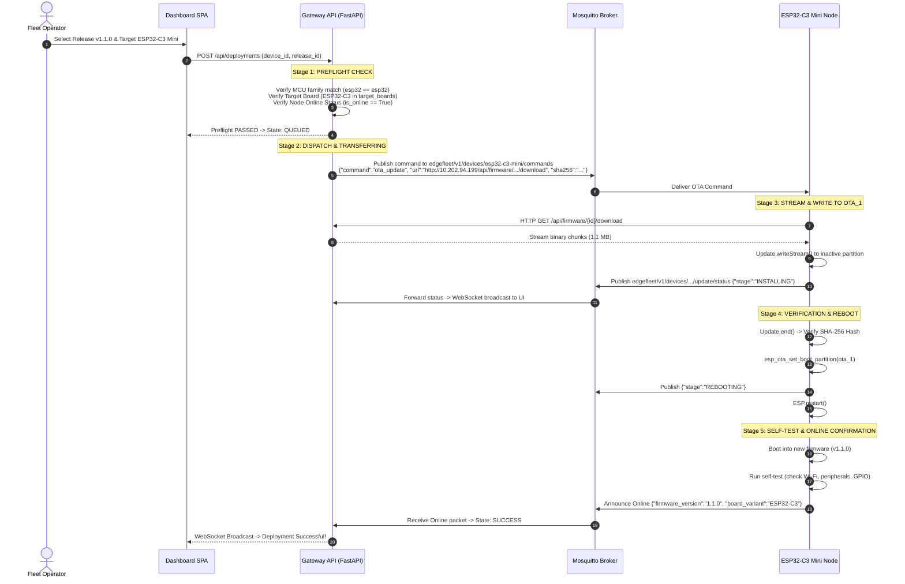

# EdgeFleet: Comprehensive System Architecture, Engineering Deep Dive & Future Scope

---

## 1. Executive Summary & Most Eligible Problem Statement

### 1.1 The Industry Problem Context
In modern Internet of Things (IoT) ecosystems—spanning smart factories, precision agriculture, municipal infrastructure, and energy grids—microcontroller-based edge nodes operate in remote, distributed, and often hostile environments. Unlike general-purpose compute servers, embedded edge nodes:
- Lack local display interfaces, keyboards, or human operators.
- Operate on constrained hardware (CISC/RISC microcontrollers with tens of kilobytes to a few megabytes of memory).
- Are often physically inaccessible (mounted on utility poles, embedded inside industrial machines, or deployed across agricultural fields).
- Run disparate architectures simultaneously: e.g., low-cost 8-bit Harvard architecture nodes (ATmega328P/Arduino Uno) wired over industrial serial buses alongside 32-bit RISC-V nodes (ESP32-C3 Mini) connected via 2.4 GHz IEEE 802.11 Wi-Fi.

When bugs, protocol changes, or critical security vulnerabilities arise, deploying firmware updates to these heterogeneous fleets presents severe risks:
1. **The "Bricking" Hazard**: An interrupted flash, memory overflow, or corrupt binary can leave a node non-bootable ("bricked"), requiring expensive truck rolls, physical disassembly, and manual ISP reprogramming.
2. **Network Fragility**: Over-The-Air (OTA) updates over unstable field links frequently suffer packet loss, dropped connections, and bitrot.
3. **Architectural Incompatibility**: Pushing a binary compiled for one microcontroller family (e.g. ESP32-S3 or ATmega) to a different target (e.g. ESP32-C3 RISC-V) causes immediate hardware panics or silent failure.
4. **Cloud Dependency & Security Gaps**: Cloud-only IoT platforms (AWS IoT Greengrass, Azure IoT Hub, Blynk, ThingSpeak) require continuous high-bandwidth internet connectivity and expose edge nodes to external attack surfaces if local gateways are bypassed.

---

### 1.2 Most Eligible Problem Statement
> **"Design and implement an edge-native, zero-trust IoT fleet management and Firmware Over-The-Air (FOTA) lifecycle gateway capable of securely orchestrating heterogeneous edge nodes (8-bit AVR serial nodes and 32-bit RISC-V Wi-Fi microcontrollers) with deterministic preflight compatibility verification, atomic dual-partition failover, real-time telemetry streaming, and resilient public tunneling without mandatory external cloud lock-in."**

---

## 2. System Architecture & Topology

EdgeFleet employs a **Hierarchical Edge-Gateway Topology** that isolates field microcontrollers within an air-gapped or localized subnet managed by a high-availability Raspberry Pi 4 edge gateway, exposed securely to global operators via Cloudflare Zero-Trust Tunnels.

```
                              ┌───────────────────────────────────────────────┐
                              │            Web / Mobile Operators             │
                              │       (React 18 + TypeScript Dashboard)       │
                              └───────────────────────┬───────────────────────┘
                                                      │ HTTPS / WSS
                                                      ▼
                              ┌───────────────────────────────────────────────┐
                              │     Cloudflare Edge / Zero-Trust Tunnel       │
                              │     (Dynamic secure ingress via cloudflared)  │
                              └───────────────────────┬───────────────────────┘
                                                      │ Reverse Proxy (Port 80)
                                                      ▼
┌─────────────────────────────────────────────────────────────────────────────────────────────────────────────┐
│ RASPBERRY PI 4 EDGE GATEWAY (ARM64 Debian Linux)                                                           │
│                                                                                                             │
│  ┌────────────────────────┐      ┌───────────────────────────────┐      ┌──────────────────────────────┐  │
│  │   Nginx Reverse Proxy  │ ───► │ FastAPI REST & WebSocket App  │ ───► │  SQLite Database with WAL    │  │
│  │   (Static SPA + Auth)  │      │ (Uvicorn Async Event Loop)    │      │  (/opt/edgefleet/backend/db) │  │
│  └────────────────────────┘      └──────────────┬────────────────┘      └──────────────────────────────┘  │
│                                                 │                                                           │
│             ┌───────────────────────────────────┼───────────────────────────────────┐                       │
│             │                                   │                                   │                       │
│             ▼                                   ▼                                   ▼                       │
│  ┌──────────────────────┐             ┌───────────────────┐             ┌───────────────────────┐           │
│  │ Mosquitto Broker     │             │ ESP32-C3 Adapter  │             │ Arduino Uno Adapter   │           │
│  │ (MQTT Port 1883)     │             │ (HTTP FOTA Engine)│             │ (avrdude Serial STK500)│          │
│  └──────────┬───────────┘             └─────────┬─────────┘             └───────────┬───────────┘           │
└─────────────┼───────────────────────────────────┼───────────────────────────────────┼───────────────────────┘
              │ MQTT Commands & Telemetry         │ HTTP Binary Download (10.202.94.199)│ USB Serial (/dev/ttyACM0)
              │                                   │                                   │
              ▼                                   ▼                                   ▼
┌─────────────────────────────────────────────────────────┐               ┌───────────────────────────────┐
│ ESP32-C3 MINI WI-FI NODE                                │               │ ARDUINO UNO HARDWARE NODE     │
│ - RISC-V 32-bit Single-Core Microcontroller             │               │ - ATmega328P 8-bit AVR Core   │
│ - Dual-Partition OTA Scheme (ota_0 / ota_1)             │               │ - Optiboot Bootloader @ 115200│
│ - Onboard Dual-Pin LED (GPIO 8 / GPIO 7)                │               │ - STK500 High-Speed Protocol  │
│ - Wi-Fi 802.11b/g/n (Local Subnet 10.202.94.37)         │               │ - Physical USB Serial Cable   │
└─────────────────────────────────────────────────────────┘               └───────────────────────────────┘
```

---

## 3. Domain-by-Domain Technical Breakdown

### 3.1 Hardware Edge Nodes

#### 1. ESP32-C3 Mini (Wi-Fi Node)
- **Architecture**: 32-bit RISC-V single-core microprocessor (Espressif ESP32-C3, clocked at 160 MHz).
- **Physical Pinout**:
  - `GPIO 8`: Active-low status LED (SuperMini variant).
  - `GPIO 7`: Active-low status LED (LOLIN C3 Mini variant).
  - Dual-pin active blinking ensures visual feedback regardless of physical board manufacturer.
- **Partition Layout (Dual A/B OTA)**:
  - `nvs`: Non-volatile storage for Wi-Fi credentials and calibration (16 KB).
  - `otadata`: Boot selector state flags indicating active partition and rollback counters (8 KB).
  - `ota_0`: Primary application partition (~1.2 MB).
  - `ota_1`: Secondary application partition (~1.2 MB).
  - `spiffs`: Local asset/telemetry scratch space.
- **Boot Safety Guarantee**: If an OTA payload fails to verify or crashes during early boot, the hardware hardware watchdog and bootloader automatically roll back to the previously operational partition.

#### 2. Arduino Uno R3 (Serial Node)
- **Architecture**: 8-bit Microchip AVR ATmega328P (16 MHz Harvard architecture, 32 KB Flash, 2 KB SRAM).
- **Interfacing**: Direct USB-to-UART bridging via ATmega16U2/CH340 enumerated as `/dev/ttyACM0` or `/dev/ttyUSB0`.
- **Flashing Protocol**: Microchip STK500v1 protocol over UART at 115,200 baud managed directly by `avrdude` subprocess orchestration inside the Python gateway adapter.

---

### 3.2 Gateway Software Architecture (Raspberry Pi 4)

#### 1. Application Server (`FastAPI` + `Uvicorn`)
- **Async Runtime**: Python 3.11+ asynchronous event loop handles concurrent HTTP client requests, WebSocket multiplexing, and background flashing threads simultaneously without blocking.
- **Database Engine**: SQLite 3 configured with `PRAGMA journal_mode=WAL;` (Write-Ahead Logging). This allows multiple readers to read concurrently while background ingestion processes write telemetry records.
- **Security & RBAC**:
  - Stateless JSON Web Tokens (JWT) signed with HMAC-SHA256 (`HS256`).
  - Passwords salted and hashed with `bcrypt`.
  - Three distinct role tiers: `admin` (firmware upload, device deletion, user provisioning), `operator` (deployment execution, device metadata edits), and `viewer` (read-only telemetry inspection).

#### 2. Messaging & Telemetry Pipeline (`Mosquitto` + `paho-mqtt`)
- **Broker**: Mosquitto MQTT v2.0 listening on port 1883.
- **Topics Schema**:
  - `edgefleet/v1/devices/{device_id}/telemetry`: Real-time sensor metrics (temperature, humidity, RSSI, free heap, battery voltage).
  - `edgefleet/v1/devices/{device_id}/status`: LWT (Last Will and Testament) and online announcements containing IP, firmware version, and uptime.
  - `edgefleet/v1/devices/{device_id}/commands`: Asynchronous execution payloads (`ota_update`, `reboot`, `config_set`).
  - `edgefleet/v1/devices/{device_id}/update/status`: Fine-grained OTA download progress reporting from microcontroller to gateway.

#### 3. Frontend Single Page Application (`React 18` + `TypeScript` + `Vite`)
- Built with Tailwind-inspired custom CSS variables for ultra-clean industrial dark mode aesthetics.
- Real-time reactivity via WebSocket connections to `ws://.../ws/devices` and `ws://.../ws/deployments`.
- Visual features:
  - Dynamic fleet health cards with online/offline pulsing badges.
  - Firmware Releases & Binary Registry with instant SHA-256 integrity inspection, target board filtering, and release deletion.
  - Live deployment progress tracking with step-by-step stage visualization (`QUEUED` ➔ `PREFLIGHT` ➔ `TRANSFERRING` ➔ `INSTALLING` ➔ `VERIFYING` ➔ `SUCCESS`).

#### 4. Networking, Reverse Proxy & Public Ingress
- **Nginx**: Terminates HTTP traffic on port 80, serves production static SPA assets, and proxies `/api/*` and `/ws/*` endpoints to Uvicorn at `127.0.0.1:8000`.
- **Cloudflare Tunnel (`cloudflared`)**: Creates an outbound encrypted tunnel to Cloudflare edge points. This exposes the EdgeFleet gateway to global networks without requiring public static IPs, port forwarding, or firewall holes.

---

## 4. End-to-End Working Principles

### 4.1 Secure Over-The-Air (FOTA) Lifecycle for ESP32-C3 Mini

The FOTA update workflow implements a strict 7-stage state machine designed to prevent bradcasting broken builds:



---

### 4.2 Serial In-System Programming for Arduino Uno (ATmega328P)

1. **Lock Acquisition**: Gateway acquires exclusive file lock on `/dev/ttyACM0` to prevent collision with background telemetry monitors.
2. **DTR Auto-Reset**: DTR pin toggled low to engage the Optiboot bootloader on the ATmega328P.
3. **Avrdude Invocation**: Gateway executes `avrdude -v -p atmega328p -c arduino -P /dev/ttyACM0 -b 115200 -U flash:w:{hex_path}:i`.
4. **Verification**: `avrdude` reads back written flash memory byte-for-byte to verify checksum match against the Intel HEX payload.
5. **Release & Handshake**: Port released back to telemetry daemon, which reads newly formatted serial packets from the updated Arduino firmware.

---

## 5. Current System Capabilities (State of the Project)

| Domain | Feature | Implementation Detail |
| :--- | :--- | :--- |
| **Edge Hardware** | Dual Microcontroller Support | Native handling of ESP32-C3 Mini (Wi-Fi) and Arduino Uno (Serial). |
| **FOTA Reliability**| Preflight Compatibility | Automatic cross-validation of MCU family, board variant, and online status before flash dispatch. |
| **FOTA Safety** | Dual-Partition A/B Fallback | ESP32-C3 boots into inactive slot; failsafe rollback prevents bricking. |
| **Security** | Role-Based Access Control | JWT authentication with Admin, Operator, and Viewer permissions. |
| **Integrity** | Cryptographic Checksums | Strict SHA-256 verification of firmware binaries during upload and device flashing. |
| **Observability** | Live Real-Time Dashboard | Reactive UI powered by WebSockets for instant status, telemetry, and log streaming. |
| **Fleet Ops** | Binary Lifecycle Management | Dynamic upload, target-board tagging, release deprecation, and disk cleanup deletion. |
| **Public Access** | Cloudflare Zero Trust | Secure HTTPS tunnel without port forwarding or dynamic DNS requirements. |

---

## 6. Future Scope & Roadmap

1. **Cryptographic Signature Verification (Ed25519 / ECDSA)**:
   - Incorporate asymmetric cryptographic signing directly into the bootloader. Microcontrollers verify public keys embedded in hardware eFuses before executing any downloaded binary.
2. **Peer-to-Peer Mesh FOTA (ESP-NOW Mesh)**:
   - Extend updates to edge nodes located outside Wi-Fi range by allowing the primary ESP32-C3 Mini node to act as a mesh cluster head, relaying binary chunks across sub-nodes over ESP-NOW.
3. **Cellular & Satellite Gateway Uplinks (NB-IoT / LTE-M)**:
   - Introduce low-bandwidth delta updates (Courgette/BSDiff) enabling multi-megabyte binaries to be compressed to 50 KB patches for cellular field deployments.
4. **Edge AI & Predictive Anomaly Detection**:
   - Run lightweight TinyML models on the Raspberry Pi gateway to detect irregular telemetry trends (voltage dips, abnormal reboot frequencies) and preemptively freeze risky firmware rollouts.
